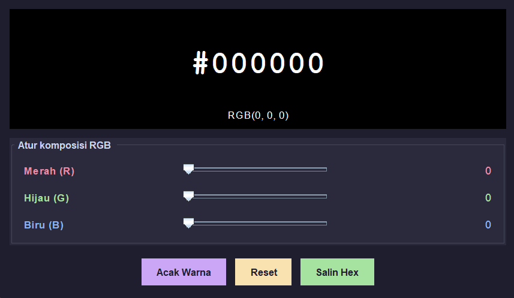
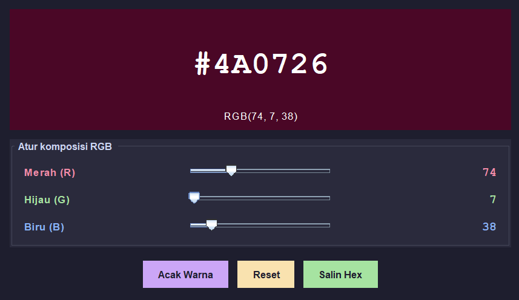

# 🎨 Color Mixer

> **Java Swing GUI** app that lets you mix colors live using RGB sliders. 🌈

---

## ✨ Features

- 🎚️ **Live RGB mixing**: drag the Red, Green, and Blue sliders and watch the color change instantly
- 🔤 **Hex code display**: shows the color code (e.g. `#FF8800`) right on the preview
- 🌓 **Smart text color**: the hex text switches between black and white so it's always readable
- 🎲 **Random color**: one click to get a surprise color
- 🔄 **Reset**: bring everything back to black
- 📋 **Copy Hex**: copy the current color code to your clipboard
- 🌙 **Dark theme**: modern look with color-coded labels and live RGB values
- 💬 **Click the preview**: pops up a dialog with the color code
- 🚪 **Exit confirmation**: asks "Are you sure?" before closing the window

---

## 🖼️ Layout Overview

<p align="center">
  
  &nbsp;&nbsp;
  
</p>

<p align="center">
  <em>🖥️ Color Mixer in action: mixing colors with the RGB sliders</em>
</p>

🧱 The window is built from three panels arranged with `BorderLayout`:

```
┌──────────────────────────────────┐
│  🎨 Color Mixer                  │  ← JFrame (top-level container)
├──────────────────────────────────┤
│                                  │
│          #FF8800                 │  ← previewPanel (NORTH)
│                                  │
├──────────────────────────────────┤
│  Merah (R)  ──────●────────      │
│  Hijau (G)  ────●──────────      │  ← sliderPanel (CENTER)
│  Biru (B)   ─●─────────────      │
├──────────────────────────────────┤
│ [ Acak Warna ] [ Reset ] [ Salin ]│  ← buttonPanel (SOUTH)
└──────────────────────────────────┘
```

---

## 🧩 Concepts Covered

| 📚 Concept | 🛠️ Used in this project |
|---|---|
| 🪟 **Top-level container** | `JFrame` |
| 📦 **Intermediate container** | `JPanel` (x3) |
| 🔘 **Atomic components** | `JLabel`, `JSlider`, `JButton` |
| 📐 **Layout managers** | `BorderLayout`, `GridLayout`, `FlowLayout` |
| 👂 **Event listeners** | `ChangeListener`, `ActionListener`, `MouseAdapter`, `WindowAdapter` |
| 💬 **Dialogs** | `JOptionPane` (message and confirm dialogs) |

---

## 📁 Project Structure

```
📦 ColorMixer
 ┣ 📜 Main.java                 → 🚀 Entry point (starts the app)
 ┣ 📜 MixerFrame.java           → 🏠 The window, panels, components, and color logic
 ┣ 📜 SliderHandler.java        → 🎚️ Listens to slider changes
 ┣ 📜 ButtonHandler.java        → 🔘 Listens to button clicks
 ┣ 📜 PreviewClickHandler.java  → 🖱️ Listens to clicks on the color preview
 ┗ 📜 CloseHandler.java         → 🚪 Listens to the window close button
```

| 📄 File | 🎯 Responsibility |
|---|---|
| `Main.java` | Starts the GUI safely on the Swing thread |
| `MixerFrame.java` | Builds the UI, lays out components, registers listeners, updates colors |
| `SliderHandler.java` | Calls `updateWarna()` whenever a slider moves |
| `ButtonHandler.java` | Uses `getActionCommand()` to tell "random" and "reset" apart |
| `PreviewClickHandler.java` | Shows the hex code in a dialog on click |
| `CloseHandler.java` | Shows a Yes/No confirmation before exiting |

---

## 🚀 How to Run

### ✅ Requirements
- ☕ **Java JDK 8 or newer** (check with `java -version`)

### ▶️ Steps

1. 📂 Put all `.java` files in the **same folder**
2. 🖥️ Open a terminal in that folder
3. 🔨 Compile:
   ```bash
   javac *.java
   ```
4. 🎉 Run:
   ```bash
   java Main
   ```

---

## 🔄 How It Works (Delegation Event Model)

```
 👆 User drags a slider        →  Event Source   (JSlider)
        │
        ▼
 📨 ChangeEvent is created     →  Event Object
        │
        ▼
 👂 SliderHandler.stateChanged →  Event Listener
        │
        ▼
 🎨 mixer.updateWarna()        →  Reaction: preview color + hex text update
```

1. 📝 **Register**: `launchFrame()` attaches each listener to its component
2. 🔔 **Fire**: when the user interacts, the component creates an event object
3. 🧠 **React**: the listener's method runs and updates the UI

---

## 🧠 Design Notes

- 🔐 **Encapsulation**: all fields in `MixerFrame` are `private`. Handlers only use `public` methods like `updateWarna()`, `acakWarna()`, `resetWarna()`, `getFrame()`, and `getKodeHex()`.
- 🔑 **Passing a reference**: each handler receives the `MixerFrame` object through its constructor (`new SliderHandler(this)`), so it can talk to the window it belongs to.
- 🏷️ **Action commands**: buttons are told apart by `setActionCommand("acak")` / `("reset")`, so the handler doesn't need to know the button variables.
- 🪶 **Adapters**: `MouseAdapter` and `WindowAdapter` let us override just one method instead of writing many empty ones.
- 🧵 **Thread safety**: `SwingUtilities.invokeLater(...)` runs the GUI on the Event Dispatch Thread, the recommended practice for Swing.
- 🚪 **Safe closing**: `DO_NOTHING_ON_CLOSE` lets us ask for confirmation before exiting.

---

## 🧪 Try It Out

| 🎮 Action | 👀 Expected result |
|---|---|
| Drag **Merah (R)** to max | Preview turns red, hex becomes `#FF0000` |
| Max all three sliders | Preview turns white, hex text turns black ⚪ |
| Click **Acak Warna** 🎲 | Sliders jump to random values and the color changes |
| Click **Reset** 🔄 | Everything returns to `#000000` |
| Click the preview 🖱️ | A dialog shows the current color code |
| Click the window **X** ❌ | A confirmation dialog appears; **No** keeps the app open |

---

## 💡 Ideas for Improvement

- ⌨️ Add a `JTextField` to type a hex code directly
- 🎨 Add a `JComboBox` with color presets
- 📋 Add a "Copy to clipboard" button
- 💾 Save favorite colors to a list (`JList`)
- 🌙 Add a dark-mode toggle

---

## 👩‍💻 Author

>>> Name : Amanda Rezquita Jamila 
>>> NIM  : F1D02510103
